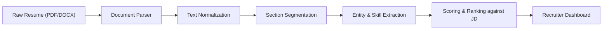

# 🎓 AI-Based Resume Analyzer: The Complete Learning Guide

Welcome to the comprehensive technical and educational companion for the **AI Resume Analyzer & Job Fit Engine**. This guide breaks down the core theoretical concepts, mathematical formulas, algorithms, and engineering patterns used in this project.

---

## 📑 Table of Contents

1. [Anatomy of an Applicant Tracking System (ATS)](#1-anatomy-of-an-applicant-tracking-system-ats)
2. [Document Ingestion & Text Processing](#2-document-ingestion--text-processing)
3. [Vector Space Models & TF-IDF Mathematics](#3-vector-space-models--tf-idf-mathematics)
4. [Taxonomy Extraction & Boundary Regex](#4-taxonomy-extraction--boundary-regex)
5. [ATS Diagnostic Scoring Heuristics](#5-ats-diagnostic-scoring-heuristics)
6. [Hybrid Generative AI & Google Gemini Integration](#6-hybrid-generative-ai--google-gemini-integration)
7. [The STAR Method for Bullet Point Engineering](#7-the-star-method-for-bullet-point-engineering)
8. [Architectural Patterns & Production Next Steps](#8-architectural-patterns--production-next-steps)

---

## 1. Anatomy of an Applicant Tracking System (ATS)

Over 90% of Fortune 500 companies use an Applicant Tracking System (e.g., Workday, Greenhouse, Lever, Taleo) to screen incoming candidates. Understanding how these systems operate is the foundation of building a resume analyzer.



### Common ATS Parsing Pitfalls:
1. **Multi-Column Layouts**: When resumes use complex two-column tables, naive parsers read line-by-line horizontally across columns, interleaving sentences from completely different sections.
2. **Icons in Place of Text**: Replacing text like "Email:" or "Phone:" with graphic icons often prevents basic regex extractors from capturing contact information.
3. **Keyword Stuffing**: Repetitive, hidden, or white-colored keywords are penalized by modern semantic analyzers, which evaluate semantic context rather than raw word frequency.

---

## 2. Document Ingestion & Text Processing

### PDF vs. DOCX Extraction

- **PDF Documents** (`pypdf`): PDFs are layout-oriented file formats where text is stored as positioned glyphs on a coordinate plane rather than sequential paragraphs. We use `pypdf.PdfReader` to extract character streams per page, followed by unicode normalization to standardize divergent glyph encodings.
- **DOCX Documents** (`python-docx`): Microsoft Word documents are ZIP archives containing XML nodes (`document.xml`). We traverse both `<w:p>` (paragraphs) and `<w:tbl>` (table cells) to ensure text inside skills tables is not dropped.

### Text Normalization Pipeline (`src/extractor.py`)
```python
def clean_text(text: str) -> str:
    # 1. Normalize bullet characters (unicode \u2022, \u2023, \u25E6, etc.)
    text = re.sub(r"[\u2022\u2023\u25E6\u2043\u2219\u25AA\u25CF]\s*", "\n• ", text)
    # 2. Normalize smart punctuation
    text = text.replace("\u2013", "-").replace("\u2014", "-")
    # 3. Collapse excessive empty newlines
    text = re.sub(r"\n{3,}", "\n\n", text)
    return text.strip()
```

### Section Segmentation Heuristic
Resumes do not follow a strict schema, but standard resumes organize information under recognizable headings. The segmenter:
1. Identifies short candidate heading lines ($\le 40$ characters).
2. Matches against compiled regex variants for canonical sections (`summary`, `experience`, `education`, `skills`, `projects`, `certifications`).
3. Groups following lines into that section until a new section header is encountered.

---

## 3. Vector Space Models & TF-IDF Mathematics

To measure how well a resume matches a job description beyond simple keyword counting, we construct a **Vector Space Model** using **TF-IDF** (Term Frequency - Inverse Document Frequency).

### 1. Term Frequency (TF)
Measures how frequently a term $t$ appears in document $d$:

$$\text{TF}(t, d) = \frac{f_{t,d}}{\sum_{t' \in d} f_{t',d}}$$

To prevent terms that appear 20 times from dominating terms that appear 5 times, we use **sublinear TF scaling**:

$$\text{Sublinear TF}(t, d) = 1 + \log(\text{TF}(t, d)) \quad \text{for } \text{TF} > 0$$

### 2. Inverse Document Frequency (IDF)
Measures how rare or informative a term is across the entire corpus $D$ of $N$ documents:

$$\text{IDF}(t, D) = \log\left(\frac{1 + N}{1 + |\{d \in D : t \in d\}|}\right) + 1$$

- Stopwords like *"and"*, *"the"*, *"with"* appear in every document, giving them an IDF close to zero.
- Domain-specific terms like *"Kubernetes"* or *"PyTorch"* appear only in relevant contexts, receiving high IDF weights.

### 3. The Combined TF-IDF Weight
$$\text{TF-IDF}(t, d, D) = \text{TF}(t, d) \times \text{IDF}(t, D)$$

### 4. Cosine Similarity
Once the resume and job description are converted into TF-IDF vectors $\mathbf{u}$ and $\mathbf{v}$, we compute the **cosine of the angle between them**:

$$\cos(\theta) = \frac{\mathbf{u} \cdot \mathbf{v}}{\|\mathbf{u}\|_2 \|\mathbf{v}\|_2} = \frac{\sum_{i=1}^n u_i v_i}{\sqrt{\sum_{i=1}^n u_i^2} \sqrt{\sum_{i=1}^n v_i^2}}$$

- $\cos(\theta) = 1.0$: Identical vocabulary distribution (100% match).
- $\cos(\theta) = 0.0$: Orthogonal vectors with zero common vocabulary.

### 5. Why N-Grams Matter
A unigram model treats *"machine"* and *"learning"* separately. By configuring `ngram_range=(1, 2)`, the model preserves bigram context like *"machine learning"*, *"system design"*, and *"fast api"*.

---

## 4. Taxonomy Extraction & Boundary Regex

### The False Positive Challenge
In software resumes, many critical technologies have short or common names:
- **Go** (Programming language vs. common English verb "go")
- **R** (Statistical language vs. random single letter)
- **C** (Language vs. grade or section label)
- **C++**, **C#**, **.NET** (Contain regex metacharacters `+`, `#`, `.`)

### The Solution: Dynamic Boundary Compilation
In `src/skills_db.py`, we dynamically generate boundaries:
- If a token begins/ends with alphanumeric characters, apply word boundary `\b`.
- If a token contains non-word characters (like `C++` or `Next.js`), escape it safely using `re.escape()` and match surrounding whitespace or punctuation separators `(?:^|[\s,;/()\[\]])`:

```python
def _build_regex_pattern(skill: str) -> re.Pattern:
    escaped = re.escape(skill)
    prefix = r"\b" if re.match(r"^\w", skill) else r"(?:^|[\s,;/()\[\]])"
    suffix = r"\b" if re.match(r".*\w$", skill) else r"(?:$|[\s,;/()\[\]])"
    return re.compile(f"{prefix}{escaped}{suffix}", re.IGNORECASE)
```

---

## 5. ATS Diagnostic Scoring Heuristics

The ATS Score is calculated on a weighted scale of **0 to 100 points**:

| Component | Max Points | Evaluation Criteria |
| :--- | :---: | :--- |
| **Section Completeness** | 20 | Detects Experience (8 pts), Skills (5 pts), Education (4 pts), Summary/Projects (3 pts) |
| **Contact Information** | 15 | Detects Email (6 pts), Phone (5 pts), LinkedIn/GitHub link (4 pts) |
| **Action Verb Strength** | 25 | Counts strong verbs (`spearheaded`, `architected`); penalizes passive phrases (`helped with`, `responsible for`) |
| **Quantifiable Metrics** | 25 | Identifies percentages, currencies, scale multipliers (`4x`), and large numbers |
| **Length & Formatting** | 15 | Ideal word count (400–900 words: 8 pts); bullet point usage (6+ bullets: 7 pts) |
| **Buzzword Penalty** | -5 | Deducts 2 points per vague cliché (`team player`, `go-getter`, `synergy`) |

---

## 6. Hybrid Generative AI & Google Gemini Integration

A key architectural design in this project is **Graceful Degradation**:
- **Offline Mode**: Uses local deterministic rules, pre-computed TF-IDF, and template-based coaching when no API key is provided.
- **Live LLM Mode**: Calls Google Gemini (`gemini-3.8-flash`) via the modern `google-genai` SDK (`client.interactions.create`).

### Prompt Engineering Pattern for Deterministic JSON
To reliably parse LLM responses into application UI elements, the prompt:
1. Enforces an explicit role (*"Executive Recruiter and ATS Specialist"*).
2. Injects the pre-computed metrics (*Match Score, ATS Score, Matched Skills, Missing Skills*) so the LLM doesn't have to re-compute arithmetic.
3. Provides a strict JSON schema and requests clean output.
4. Uses regex extraction `re.search(r"\{[\s\S]*\}", text)` as a safety fallback in case the LLM wraps output in markdown codeblocks.

---

## 7. The STAR Method for Bullet Point Engineering

Recruiters evaluate work experience bullets through the **STAR Method**:
- **S**ituation: The context or business environment.
- **T**ask: The challenge, objective, or bottleneck faced.
- **A**ction: The specific technical steps, tools, and decisions executed.
- **R**esult: The quantifiable business or technical outcome achieved.

### Before vs. After Example

> ❌ **Weak / Passive Bullet**:
> *"Worked on backend microservices and helped with API response times."*
> - *Flaws*: Weak verbs ("worked on", "helped with"), no named technologies, zero metrics.

> ✅ **High-Impact STAR Bullet**:
> *"Architected and deployed 4 high-throughput Python/FastAPI microservices; optimized Redis caching and database query indexes to slash p99 API latency by 42% (580ms to 330ms)."*
> - *Strengths*: Strong action verbs ("Architected", "deployed", "optimized"), specific stack ("Python/FastAPI", "Redis"), clear quantifiable outcome ("42% reduction, 580ms to 330ms").

---

## 8. Architectural Patterns & Production Next Steps

If you want to extend this project into an enterprise product or portfolio milestone, consider these enhancements:

1. **Dense Semantic Embeddings**:
   - Replace or supplement TF-IDF with multimodal dense embeddings using `gemini-embedding-2` or `sentence-transformers` (`all-MiniLM-L6-v2`) to capture deep conceptual synonyms (e.g. knowing that "K8s cluster management" relates to "Container Orchestration").
2. **Vector Database Integration**:
   - Store candidate embeddings in a vector database (e.g., ChromaDB, Pinecone, or PostgreSQL with `pgvector`) to search thousands of candidate resumes against incoming job requisitions in milliseconds.
3. **FastAPI Microservice Backend**:
   - Wrap `src/` modules in FastAPI endpoints (`/api/v1/analyze`, `/api/v1/ats-check`) and deploy with Docker to Google Cloud Run or AWS ECS.
