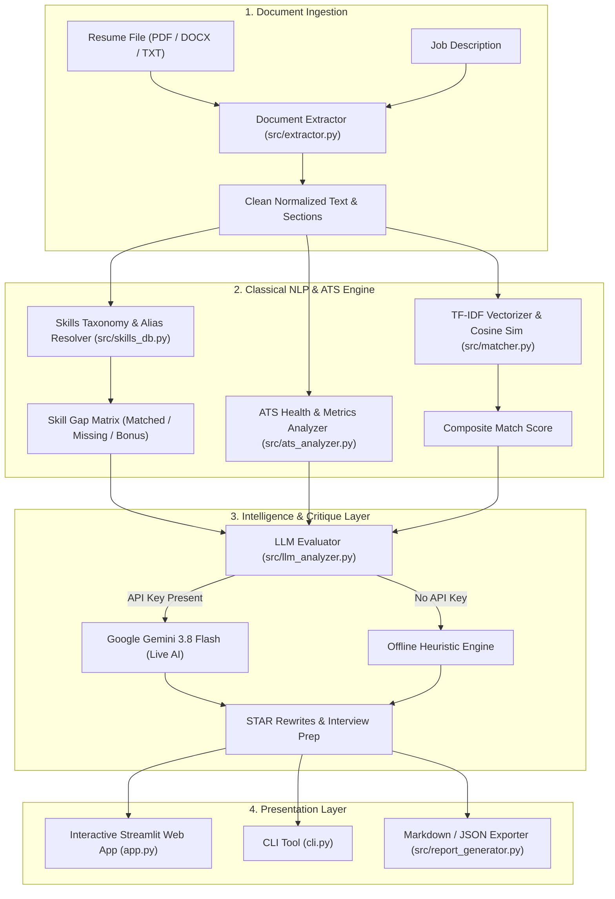

# 🎯 AI-Based Resume Analyzer & Job Fit Engine

An industry-grade, educational **AI Resume Analyzer** built in Python that combines **Classical Natural Language Processing (NLP)**, **ATS Heuristic Scoring**, and modern **Generative AI (Google Gemini 3.8 Flash)** to match resumes against target job descriptions, diagnose formatting issues, and generate high-impact career recommendations.

---

## 🌟 Key Features

- **Multi-Format Ingestion**: Parses `.pdf` (via `pypdf`), `.docx` (via `python-docx`), and `.txt` files with intelligent whitespace and bullet normalization.
- **Section Segmentation**: Automatically identifies and parses sections like *Contact Details, Professional Summary, Work Experience, Technical Skills, Education, Projects, and Certifications*.
- **1,000+ Categorized Skills Taxonomy**: Extracts and normalizes technical and soft skills across 7 domains with alias resolution (e.g., `k8s` → `Kubernetes`, `reactjs` → `React`).
- **Real-World ATS Scoring (0 - 100)**:
  - *Action Verb Strength*: Detects high-impact active verbs (`architected`, `spearheaded`) vs passive phrasing (`helped with`).
  - *Quantifiable Metrics*: Identifies percentages (`35%`), revenue (`$1.2M`), scale (`10M+ users`), and speed multipliers (`3x`).
  - *Formatting & Length Checks*: Analyzes word count, bullet density, and flags overused clichés/buzzwords.
- **TF-IDF & Cosine Similarity Matcher**: Computes mathematical vector alignment between resume vocabulary and job descriptions with n-gram support.
- **Skill Gap Analysis**: Pinpoints exact matched competencies, critical missing requirements, and bonus skills.
- **Hybrid AI Architecture**:
  - **Offline Mode**: 100% free, runs with zero internet/API dependency using local algorithms and heuristic generators.
  - **Live Gemini Mode**: When provided with a `GEMINI_API_KEY`, leverages Google Gemini `gemini-3.8-flash` via the official `google-genai` SDK to produce executive candidate critique, STAR-method bullet rewrites, and gap-focused interview questions.
- **Dual User Interfaces**:
  - **Interactive Streamlit Web Dashboard**: Modern UI with real-time gauges, badge pills, and one-click report downloads.
  - **Automated CLI Tool**: Fast command-line evaluation with markdown and JSON export capabilities.

---

## 🏗️ Architecture



---

## 🚀 Quick Start Guide

### 1. Prerequisites
- Python 3.10+ (tested on Python 3.11)

### 2. Environment Setup
```powershell
# Navigate into the project directory
cd C:\Users\Dell\.gemini\antigravity\scratch\ai-resume-analyzer

# Activate the virtual environment
.\.venv\Scripts\Activate.ps1
```

*(If creating a new virtual environment from scratch)*:
```powershell
python -m venv .venv
.\.venv\Scripts\pip install -r requirements.txt
```

### 3. Optional: Configure Gemini API Key
To enable live AI insights with **Gemini 3.8 Flash**, create a `.env` file or export your key:
```powershell
copy .env.example .env
# Edit .env and paste your GEMINI_API_KEY
```
> **Note**: If you don't provide an API key, the application works completely offline with high-quality heuristic feedback! You can also enter the API key directly in the web UI.

---

## 💻 Running the Application

### Option A: Launch the Streamlit Web Dashboard
```powershell
.\.venv\Scripts\streamlit run app.py
```
Open your browser at `http://localhost:8501`.
- Use the sidebar to select preloaded sample resumes (Software Engineer or Data Scientist) or upload your own `.pdf`, `.docx`, or `.txt` resume.
- View interactive metrics, skill gap badges, ATS checklists, STAR bullet rewrites, and download executive reports.

### Option B: Run the Command-Line Interface (CLI)
```powershell
# Run with built-in Software Engineer sample
.\.venv\Scripts\python cli.py --sample

# Analyze your custom files and export a report
.\.venv\Scripts\python cli.py --resume samples/sample_resume_swe.txt --jd samples/sample_jd_swe.txt --export my_report.md

# Output results as raw JSON
.\.venv\Scripts\python cli.py --sample --json
```

### Option C: Run the Automated Test Suite
```powershell
.\.venv\Scripts\pytest -v
```
All 16 unit tests verify parsing, taxonomy extraction, ATS scoring, and TF-IDF similarity.

---

## 📁 Project Structure

```
ai-resume-analyzer/
│
├── src/
│   ├── __init__.py            # Package metadata
│   ├── extractor.py           # Multi-format text extractor & section segmenter
│   ├── skills_db.py           # 1,000+ skills taxonomy with alias mapping
│   ├── ats_analyzer.py        # ATS scoring engine (verbs, metrics, length)
│   ├── matcher.py             # TF-IDF Cosine Similarity & skill gap engine
│   ├── llm_analyzer.py        # Gemini 3.8 Flash & offline heuristic engine
│   └── report_generator.py    # Markdown & JSON report compiler
│
├── samples/
│   ├── sample_resume_swe.txt            # Sample Senior SWE resume
│   ├── sample_jd_swe.txt                # Sample Senior SWE job description
│   ├── sample_resume_data_scientist.txt # Sample Data Scientist resume
│   └── sample_jd_data_scientist.txt     # Sample Data Scientist job description
│
├── tests/
│   ├── test_extractor.py      # Tests for text extraction & contact parsing
│   ├── test_skills_db.py      # Tests for skill extraction & word boundaries
│   ├── test_ats_analyzer.py   # Tests for ATS scoring & action verb checks
│   └── test_matcher.py        # Tests for TF-IDF similarity & skill gaps
│
├── app.py                     # Streamlit web application
├── cli.py                     # Command-line interface
├── pytest.ini                 # Pytest test configuration
├── requirements.txt           # Python package dependencies
├── .env.example               # Template for API keys
├── README.md                  # Project overview & documentation
└── LEARNING_GUIDE.md          # Comprehensive NLP & ATS technical guide
```

---

## 📖 Deep-Dive Learning Guide

For a thorough conceptual walkthrough of TF-IDF mathematics, ATS algorithms, regex parsing, and GenAI prompt engineering, read [`LEARNING_GUIDE.md`](./LEARNING_GUIDE.md).

---

## 💼 How to Showcase this in Your Portfolio

1. **GitHub Repository**:
   - Push this clean, modular repository to GitHub with the provided `README.md` and screenshots of the Streamlit dashboard.
2. **Resume Bullet Point**:
   - *"Architected an AI-powered resume and ATS analysis engine in Python using Streamlit, Scikit-Learn, and Google Gemini 3.8 Flash; engineered TF-IDF n-gram cosine matching and custom regex entity extractors over 1,000+ technical skills with 100% automated test coverage."*
3. **LinkedIn Project Post**:
   - Highlight the hybrid architecture: how classical NLP guarantees speed and zero-cost offline execution, while Gemini LLM provides contextual STAR bullet point rewrites and personalized interview simulation.
